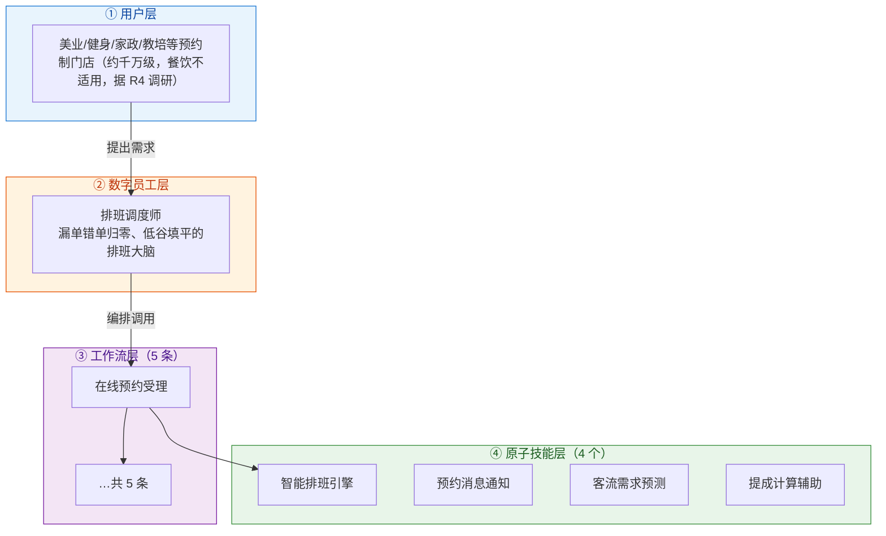
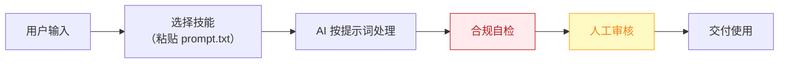

# 排班调度师 — 业务架构

## 四层视图

## 资产形态说明

本资产包为**纯提示词客户端资产**：

| 特性 | 说明 |
|------|------|
| 无运行时依赖 | 不调用任何模型 API，不需要 API Key |
| 平台无关 | 提示词为纯文本，可导入任意主流 AI 平台 |
| 用户自备算力 | 模型由用户自己的订阅提供 |
| 零服务端成本 | 资产方不产生任何调用费用 |

## 数据流

> **关键设计**：所有对外输出必须经过「合规自检 → 人工审核」双闸门。

## 能力边界

| 维度 | 内容 |
|------|------|
| **目标用户** | 美业/健身/家政/教培等预约制门店（约千万级，餐饮不适用，据 R4 调研） |
| **做** | **做**：预约受理、智能排班、冲突检测、爽约预测、到店提醒；** |
| **不做** | 不做**：不接管收银、 |
| **KPI** | 漏单错单率 → 0；爽约率下降 ≥30%；低谷时段上座率提升可追踪 |
| **定价** | 100–300 元/月（美业 SaaS 主流价位，据 R4 调研）；**代配置服务加成：800–2000 元/次**（预约入口搭建+技师与项目库灌入+小程序对接——本群体内配置难度最高，加成空间最大） |

---

*本图由 build_p0_assets.py 自动生成*
