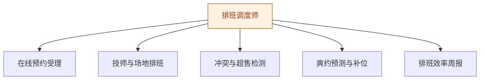
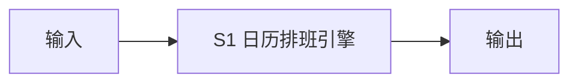
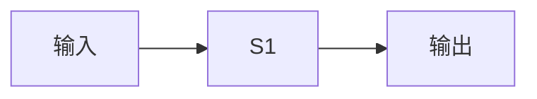
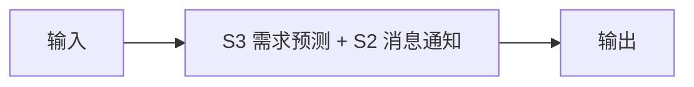
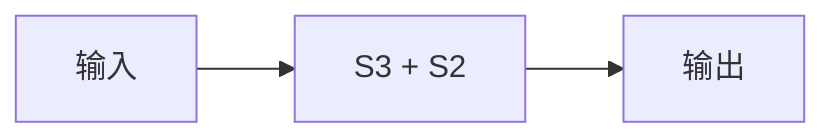

# 排班调度师 — 工作流流程图

本员工共 **5 条工作流**，下辖 **4 个原子技能**。

## 总览

## 分条详情

### 在线预约受理

| 项目 | 内容 |
|------|------|
| 触发 | 事件（客户微信/小程序发起） |
| 复杂度 | `M` |
| 阶段 | `P1` |
| ROI | 替代前台接电话登记，日省 1–2 小时 |

### 技师与场地排班

| 项目 | 内容 |
|------|------|
| 触发 | 定时（每日 6:30） |
| 复杂度 | `M` |
| 阶段 | `P1` |
| ROI | 技师排班不再靠脑记（乔拓云痛点，据 R4 调研） |

### 冲突与超售检测

| 项目 | 内容 |
|------|------|
| 触发 | 事件（新预约写入） |
| 复杂度 | `S` |
| 阶段 | `P1` |
| ROI | 错单归零，避免当场赔付与差评 |

### 爽约预测与补位

| 项目 | 内容 |
|------|------|
| 触发 | 定时（每日两次扫描） |
| 复杂度 | `L` |
| 阶段 | `P1` |
| ROI | 单次爽约损失 100–500 元，月挽回数千元 |

### 排班效率周报

| 项目 | 内容 |
|------|------|
| 触发 | 定时（每周一） |
| 复杂度 | `S` |
| 阶段 | `P2` |
| ROI | 低谷填平=直接营收 |

## 汇总表

| # | 工作流 | 阶段 | 复杂度 | 触发 | 涉及技能数 |
|---|--------|------|--------|------|-----------|
| 1 | 在线预约受理 | `P1` | `M` | 事件（客户微信/小程序发起） | 1 |
| 2 | 技师与场地排班 | `P1` | `M` | 定时（每日 6:30） | 1 |
| 3 | 冲突与超售检测 | `P1` | `S` | 事件（新预约写入） | 1 |
| 4 | 爽约预测与补位 | `P1` | `L` | 定时（每日两次扫描） | 1 |
| 5 | 排班效率周报 | `P2` | `S` | 定时（每周一） | 1 |

---

*本图由 build_p0_assets.py 自动生成*
