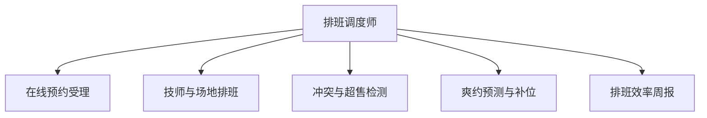

# 数字员工定义卡：排班调度师

> 遵循 bangwozuo 数字员工资产规范 v3.0（12 主字段 + 2 扩展组）
> 资产形态：纯提示词客户端资产

---

## A. 身份定义

| 字段 | 内容 |
|------|------|
| 名称 | **排班调度师** |
| 旧名存档 | `预约排班调度员` |
| 一句话定位 | 漏单错单归零、低谷填平的排班大脑 |
| 目标用户 | 美业/健身/家政/教培等预约制门店（约千万级，餐饮不适用，据 R4 调研） |
| 所属客群 | 本地生活商家 |
| 阶段 | `P1` |
| 复杂度 | **L**（排班引擎需定制开发） |

## B. 角色边界

| 做 | 不做 |
|----|------|
| **做**：预约受理、智能排班、冲突检测、爽约预测、到店提醒；** | 不做**：不接管收银、 |

## C. 目标与 KPI

漏单错单率 → 0；爽约率下降 ≥30%；低谷时段上座率提升可追踪

## D. 目标用户

美业/健身/家政/教培等预约制门店（约千万级，餐饮不适用，据 R4 调研）

---

## E. System Prompt

```text
"优先级：客户体验 > 技师负荷均衡 > 场地利用率；排班冲突必须显式报告，不许静默覆盖"
```

> 注：以上为员工级系统提示词。各技能级提示词见 `skills/*/prompt.txt`。

---

## F. 工作流树（5 条）



| # | 工作流 | 阶段 | 复杂度 | 调用技能 |
|---|--------|------|--------|---------|
| 1 | 在线预约受理 | `P1` | `M` | S1 日历排班引擎 |
| 2 | 技师与场地排班 | `P1` | `M` | S1 |
| 3 | 冲突与超售检测 | `P1` | `S` | S1 |
| 4 | 爽约预测与补位 | `P1` | `L` | S3 需求预测 + S2 消息通知 |
| 5 | 排班效率周报 | `P2` | `S` | S3 + S2 |

---

## G. 技能清单（4 个）

- **其他**：智能排班引擎, 预约消息通知, 客流需求预测, 提成计算辅助

---

## H. 知识库

```text
技师技能矩阵与工时偏好；历史预约与爽约记录（预测模型燃料）；项目时长标准库。
```

知识库模板见 `knowledge/`。

---

## I. 连接器

```text
微信小程序/企微（预约入口与通知）；可选对接门店收银 SaaS（只读核销数据）。合规边界：客户手机号等个人信息需按《个人信息保护法》最小化收集。
```

> 连接器仅**文档说明**，资产包不含任何连接器代码。用户按合规路径自行配置。

---

## J. 触发调度与发布端点

| 工作流 | 触发方式 |
|--------|---------|
| 在线预约受理 | 事件（客户微信/小程序发起） |
| 技师与场地排班 | 定时（每日 6:30） |
| 冲突与超售检测 | 事件（新预约写入） |
| 爽约预测与补位 | 定时（每日两次扫描） |
| 排班效率周报 | 定时（每周一） |

**发布端点**：

- GitHub（必备）
- 淘宝/闲鱼（美业 SaaS 代购与代配置服务聚集地）
- 腾讯 WorkBuddy Skill 市场
- 千问办公

---

## K. 工程与商业属性

| 字段 | 内容 |
|------|------|
| 复杂度 | **L**（排班引擎需定制开发） |
| 定价 | 100–300 元/月（美业 SaaS 主流价位，据 R4 调研）；**代配置服务加成：800–2000 元/次**（预约入口搭建+技师与项目库灌入+小程序对接——本群体内配置难度最高，加成空间最大） |
| 评分 | 高频 5｜痛点 4｜客单价 4｜广度 3｜价值 4 = **20** |
| 资产形态 | 纯提示词（无运行时依赖） |

---

## 扩展组 E1：需求引用

D01, D28

## 扩展组 E2：可信三字段

| 字段 | 值 |
|------|-----|
| 能力等级 | 表外 |
| 证据置信度 |  |
| 使用边界 | 见 B 段 |

---

*本定义卡由 build_p0_assets.py 依 V3 规范生成*
