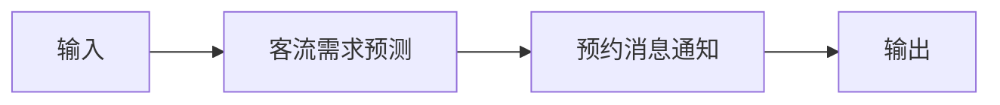

# 爽约预测与补位

## 元信息

| 字段 | 值 |
|------|-----|
| ID | `de_local_05_wf04` |
| 类型 | **`composite`（复合技能）** |
| 所属员工 | 排班调度师 |
| 阶段 | `P1` |
| 复杂度 | `L` |
| 触发方式 | 定时（每日两次扫描） |
| ROI | 单次爽约损失 100–500 元，月挽回数千元 |
| 资产形态 | 提示词编排 + Python 确定性脚本（无 API Key） |

> 复合技能 = 工作流。它把多个**原子技能**按业务顺序编排在一起，完成一个完整场景。

## 能力描述

把当日待执行预约推进到「高风险确认 + 候补补位」闭环：S1 特征打分（脚本
`scripts/run_flow.py` 确定性计算：基线 7.7%，未预付 12.3%/全款 3.1%、不指名 9.8%/
指名 5.2%、午间 12:00-14:00 系数 ×1.3、单因子上限 2.0；风险分 ≥12% 高 / 8%-12% 中 /
<8% 低）→ S2 提前确认（高风险前 2 小时短信二次确认、中风险前 30 分钟提醒，夜间静默
21:30-09:00 顺延）→ S3 候补补位（一位爽约只通知一位候补，30 分钟未确认顺延下一位）。

## 编排的原子技能

| # | 原子技能 | 能力 |
|---|---------|------|
| 1 | [客流需求预测](../../skills/traffic-demand-forecast/) | 历史数据预测未来 7 天需求（180 天历史数据预测已成行业方案，据 R4 调研） |
| 2 | [预约消息通知](../../skills/booking-notify/) | 微信/短信提醒触达 |

## 步骤链路（DAG）



## 步骤明细

| # | 步骤 | 技能资产 | 输入 | 输出 | 失败处理 |
|---|------|---------|------|------|---------|
| 1 | 客流需求预测 | [`../../skills/traffic-demand-forecast/`](../../skills/traffic-demand-forecast/) | 上一步输出 | 客流需求预测 输出 | 记录错误并中止 |
| 2 | 预约消息通知 | [`../../skills/booking-notify/`](../../skills/booking-notify/) | 上一步输出 | 预约消息通知 输出 | 记录错误并中止 |

## 步骤说明

历史爽约特征打分 → 高风险预约提前确认 → 爽约后候补名单自动通知

## 输入规格

| 字段 | 类型 | 必填 | 说明 |
|------|------|------|------|
| `input` | string / object | ✅ | 工作流初始输入，由触发条件提供 |

## 输出规格

| 字段 | 类型 | 说明 |
|------|------|------|
| `summary` | string | 执行摘要 |
| `steps` | string | 分步结果 |
| `deliverable` | string | 最终交付物 |

## 错误处理

| 情况 | 处理方式 |
|------|---------|
| 输入缺失 | 提示缺少的字段，终止流程 |
| 中间步骤输出不合规 | 合规技能拦截，返回修改建议，不继续下游 |
| 提示词被平台截断 | 拆分任务，分两次处理 |

## 验收标准

- [ ] 每一步的技能资产齐全（SKILL.md / prompt.txt / schema.json）
- [ ] 步骤间输入输出字段可衔接
- [ ] 末步输出带 AI 生成标识
- [ ] 全流程有人工确认环节

## 在平台上的编排方式

| 平台 | 编排方式 |
|------|---------|
| **Coze / 扣子** | 新建工作流 → 按步骤添加节点，每个节点填入对应技能的 prompt.txt |
| **Dify** | 新建 Workflow → 添加 LLM 节点链，按 DAG 顺序连接 |
| **WorkBuddy** | 新建 Skill，按步骤在指令中串联各技能提示词 |
| **手动使用** | 按步骤顺序，逐个把 prompt.txt 与上一步输出交给 AI |

## 使用示例

```text
第 1 步：把「客流需求预测」的 prompt.txt 粘贴到 AI，
         提供输入数据，得到输出 A。

第 2 步：把「预约消息通知」的 prompt.txt 粘贴到新的对话，
         把输出 A 作为输入，得到输出 B。

…依次类推，直到末步。
```

## 使用步骤

### 方式一：纯提示词编排（跨平台）

1. 把 `prompt.txt` 全文粘贴为系统提示词
2. 提供历史爽约统计、当日待执行预约、候补名单与触达约束
3. 按 S1→S2→S3 得到风险清单与补位排期；风险分用下方脚本实测

### 方式二：带脚本（端到端产物）

```bash
python scripts/run_flow.py --input input.json --outdir out
python scripts/run_flow.py --demo
```

## 边界（不做的事）

- ❌ 不编造历史爽约率、客户预付状态或候补名单
- ❌ 不在夜间静默段（21:30-09:00）触达；不超同一客户每日 2 条上限
- ❌ 不把「高风险」分级结论通知客户本人——仅用于内部动作
- ❌ 风险分不用模型口算——以脚本输出为准

## 调用示例

**输入**（`examples/input.json`）：2026-10-08 晚执行，近 8 周爽约率 7.7%，当晚 5 单
（3 单未预付不指名、1 单定金、1 单全款指名），候补 2 人。

**输出**（脚本实跑）：高风险 3 单（风险分 15.7%，均未预付不指名），每单预排候补触达
排期（前 2 小时触发，静默段顺延至 09:00）。产物：`out/爽约风险清单.xlsx` +
`out/爽约风险.png` + `out/noshow_flow.json`。

## 所属工作流

本资产为复合技能（工作流），调用 [客流需求预测](../../skills/traffic-demand-forecast/)
做需求预测、[预约消息通知](../../skills/booking-notify/) 做提醒触达；
下游可接 `scheduling-efficiency-weekly-flow`（周度复盘爽约率变化）。

## 合规声明

- 本工作流输出为 **AI 辅助评估结果**，触达发送前必须经老板确认、由前台执行
- 爽约记录属客户个人信息，仅用于本门店服务改进，不外传
- 请按所在平台要求完成 AI 生成内容标识

---

*本复合技能定义由 build_p0_assets.py 生成*
