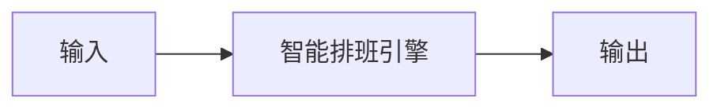

# 在线预约受理

## 元信息

| 字段 | 值 |
|------|-----|
| ID | `de_local_05_wf01` |
| 类型 | **`composite`（复合技能）** |
| 所属员工 | 排班调度师 |
| 阶段 | `P1` |
| 复杂度 | `M` |
| 触发方式 | 事件（客户微信/小程序发起） |
| ROI | 替代前台接电话登记，日省 1–2 小时 |
| 资产形态 | 提示词编排 + Python 确定性脚本（无 API Key） |

> 复合技能 = 工作流。它把多个**原子技能**按业务顺序编排在一起，完成一个完整场景。

## 能力描述

把一条客户预约请求推进到「可写单的确认档期」：S1 意图识别（从留言解析项目/时长/指名/
期望时段 4 字段）→ S2 档期匹配（脚本 `scripts/run_flow.py` 确定性排位：价目表核对 →
班次核对 → 已有预约占用含 15 分钟消毒缓冲 → 房间类型匹配 → 5 分钟粒度最早可约档期，
末单须在闭店前 60 分钟前开始）→ S3 客户确认（确认后才写单）。漏单错单归零为目标：
档期一律以脚本输出为准，不硬塞、不编造。

## 编排的原子技能

| # | 原子技能 | 能力 |
|---|---------|------|
| 1 | [智能排班引擎](../../skills/smart-scheduling-engine/) | 多资源（人/房/设备）排班与冲突检测 |

## 步骤链路（DAG）



## 步骤明细

| # | 步骤 | 技能资产 | 输入 | 输出 | 失败处理 |
|---|------|---------|------|------|---------|
| 1 | 智能排班引擎 | [`../../skills/smart-scheduling-engine/`](../../skills/smart-scheduling-engine/) | 上一步输出 | 智能排班引擎 输出 | 记录错误并中止 |

## 步骤说明

意图识别 → 项目/技师/时间匹配 → 确认

## 输入规格

| 字段 | 类型 | 必填 | 说明 |
|------|------|------|------|
| `input` | string / object | ✅ | 工作流初始输入，由触发条件提供 |

## 输出规格

| 字段 | 类型 | 说明 |
|------|------|------|
| `summary` | string | 执行摘要 |
| `steps` | string | 分步结果 |
| `deliverable` | string | 最终交付物 |

## 错误处理

| 情况 | 处理方式 |
|------|---------|
| 输入缺失 | 提示缺少的字段，终止流程 |
| 中间步骤输出不合规 | 合规技能拦截，返回修改建议，不继续下游 |
| 提示词被平台截断 | 拆分任务，分两次处理 |

## 验收标准

- [ ] 每一步的技能资产齐全（SKILL.md / prompt.txt / schema.json）
- [ ] 步骤间输入输出字段可衔接
- [ ] 末步输出带 AI 生成标识
- [ ] 全流程有人工确认环节

## 在平台上的编排方式

| 平台 | 编排方式 |
|------|---------|
| **Coze / 扣子** | 新建工作流 → 按步骤添加节点，每个节点填入对应技能的 prompt.txt |
| **Dify** | 新建 Workflow → 添加 LLM 节点链，按 DAG 顺序连接 |
| **WorkBuddy** | 新建 Skill，按步骤在指令中串联各技能提示词 |
| **手动使用** | 按步骤顺序，逐个把 prompt.txt 与上一步输出交给 AI |

## 使用示例

```text
第 1 步：把「智能排班引擎」的 prompt.txt 粘贴到 AI，
         提供输入数据，得到输出 A。

第 2 步：把「下一技能」的 prompt.txt 粘贴到新的对话，
         把输出 A 作为输入，得到输出 B。

…依次类推，直到末步。
```

## 使用步骤

### 方式一：纯提示词编排（跨平台）

1. 把 `prompt.txt` 全文粘贴为系统提示词
2. 提供客户请求与门店上下文（价目表/班次/已有预约/房间）
3. 按 S1→S2→S3 得到受理确认单；S2 的档期用下方脚本实测，不靠模型口算

### 方式二：带脚本（端到端产物）

```bash
python scripts/run_flow.py --input input.json --outdir out
python scripts/run_flow.py --demo
```

| 平台 | 编排方式 |
|------|---------|
| **Coze / 扣子** | 工作流节点填原子技能 prompt.txt，S2 用代码节点跑脚本 |
| **Dify** | Workflow → LLM 节点链 + 代码节点 |
| **WorkBuddy** | 新建 Skill 按 prompt.txt 步骤串联 |

## 边界（不做的事）

- ❌ 不编造可约档期、价目或技师班次
- ❌ 不绕过 15 分钟消毒缓冲与末单红线排单
- ❌ 不在客户未确认前写单或通知技师
- ❌ 档期不用模型口算——以脚本确定性输出为准

## 调用示例

**输入**（`examples/input.json`）：2026-10-08 14:05 林晓小程序留言「约明天下午肩颈推拿
60 分钟，指名张曼，三点左右到店」，价目表含 218 元加长版，张曼班次 12:00-20:00 已有 2 单。

**输出**（脚本实跑）：S1 解析出 肩颈推拿60分钟（加长版）/指名张曼/15:00 起；
S2 排位 15:00-16:00（避开 12:00-12:45、13:00-13:30 两单及缓冲）；
S3 待客户确认。产物：`out/受理确认单.xlsx` + `out/intake_flow.json`。

## 所属工作流

本资产为复合技能（工作流），是端到端流程的入口；上游无依赖，下游可接
`staff-room-scheduling-flow`（当日排班）与 `conflict-oversell-detect-flow`（写入后冲突扫描）。

## 合规声明

- 本工作流输出为 **AI 辅助受理结果**，写单前必须经客户确认与前台复核
- 客户手机号脱敏使用（如 138****2607），预约数据不外传
- 请按所在平台要求完成 AI 生成内容标识

---

*本复合技能定义由 build_p0_assets.py 生成*
